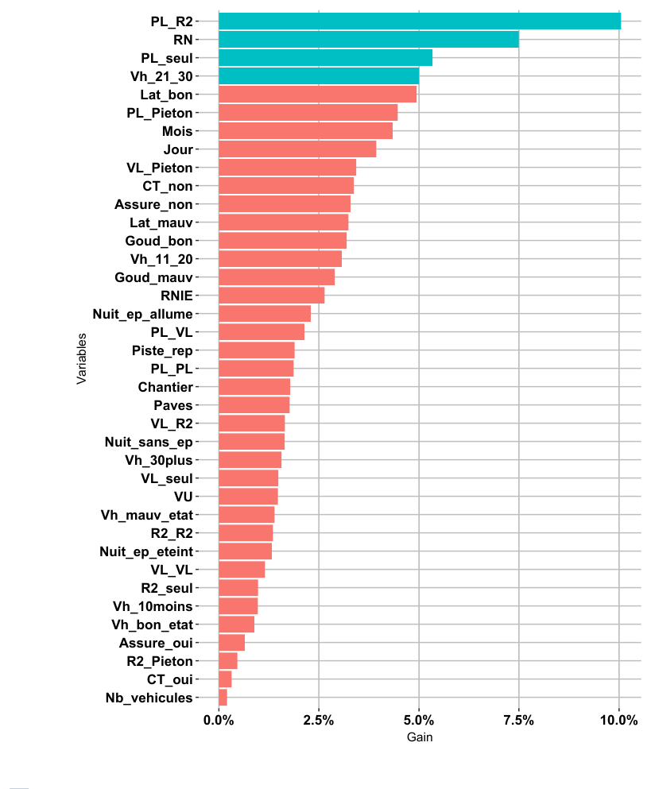
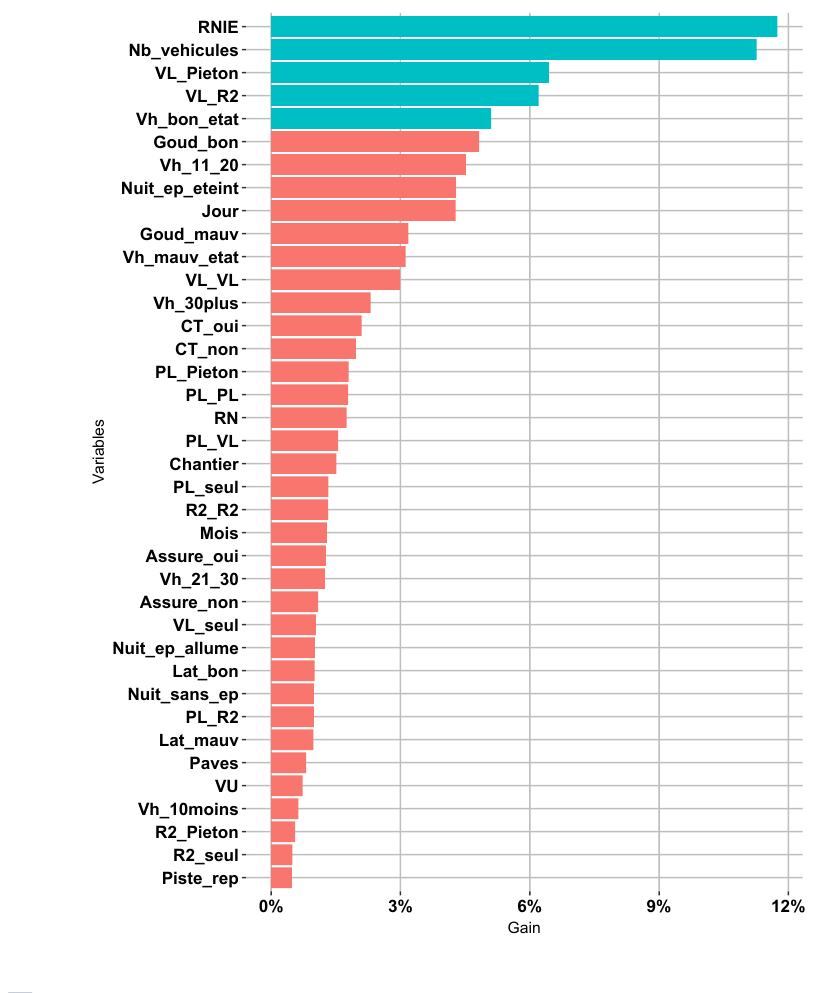
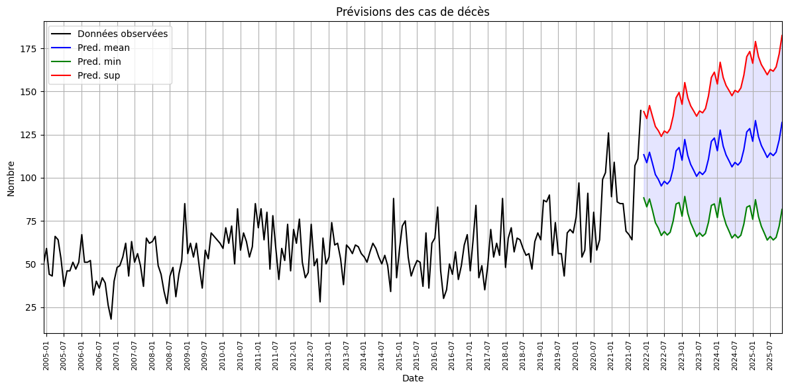
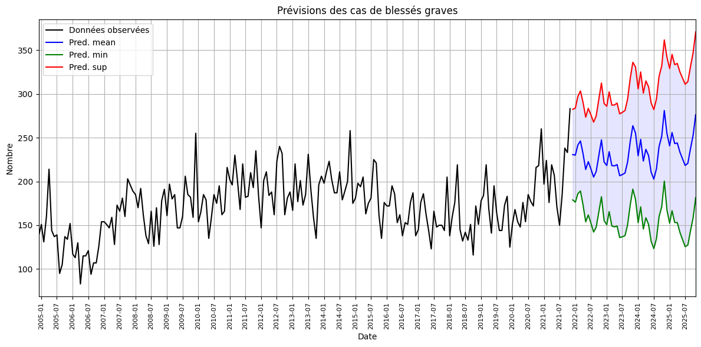

# Analyse temporelle et prédictive des risques routiers au Bénin

Mémoire de master, Master Statistique appliquée aux vivants (CIPMA, Université d'Abomey-Calavi), soutenu le 2 août 2025.

## Contexte

Les accidents de la route ont causé environ 1,19 million de décès dans le monde en 2021, soit 15 décès pour 100 000 habitants. Le Bénin en compte 25 pour 100 000 (OMS, 2023), et 5 272 blessés graves ont été recensés en 2021 (CNSR, 2022).

Les études sur les facteurs de mortalité routière utilisent souvent des modèles linéaires généralisés classiques. Or le nombre mensuel de victimes dépend en partie des mois précédents, et ignorer cette dépendance fausse l'estimation de la significativité des facteurs. Ce travail cherche à répondre à la question suivante : **quels facteurs contextuels expliquent la persistance de la mortalité routière au Bénin ?**

## Données

Données mensuelles agrégées du Centre national de sécurité routière (CNSR), de janvier 2005 à décembre 2021 (204 mois) :

- **variables à expliquer** : nombre de décès, nombre de blessés graves, et leur total (accidentologie) ;
- **variables explicatives** : nombre d'accidents selon le type de route, l'état de la chaussée, l'éclairage, l'âge et l'état des véhicules, le type de collision, l'assurance et le contrôle technique.

Les données ne sont pas publiques et ne sont pas incluses dans ce dépôt.

## Démarche

1. **Repérer les variables prédictives** avec Random Forest et XGBoost : apprentissage sur 2005-2019 (180 mois), test sur 2020-2021 (24 mois), comparaison par RMSE, MAE et MAPE.
2. **Quantifier l'effet de chaque facteur** avec un modèle GLARMA binomial négatif, qui combine une régression de comptage et une composante modélisant la dépendance aux résidus passés :

   log E[Yₜ] = β₀ + Σⱼ βⱼ Xⱼ,ₜ + Σₖ φₖ Zₜ₋ₖ

   Les variables sont sélectionnées par élimination descendante sur l'AIC. Pour les décès, le logarithme du nombre d'accidents du mois est utilisé comme offset : le modèle porte alors sur le taux de décès par accident.
3. **Prévoir** l'évolution des séries avec SARIMA et LSTM (sous Python, non inclus dans ce dépôt).

## Résultats

### Prédiction : Random Forest et XGBoost

Erreurs sur les 24 mois de test (2020-2021) :

| Cible | Modèle | RMSE | MAE | MAPE |
|---|---|---|---|---|
| Décès | Random Forest | 29,44 | 23,62 | 24,42 % |
| Décès | XGBoost | 26,72 | 21,16 | 21,81 % |
| Blessés graves | Random Forest | 37,33 | 29,04 | 13,94 % |
| Blessés graves | XGBoost | 34,03 | 26,65 | 12,92 % |
| Décès + blessés graves | Random Forest | 48,92 | 36,76 | 11,22 % |
| Décès + blessés graves | XGBoost | 45,29 | 34,86 | 10,84 % |

XGBoost fait mieux que Random Forest sur les trois cibles. Ses importances de variables servent à orienter la modélisation GLARMA.



*XGBoost : variables importantes pour le nombre de décès.*



*XGBoost : variables importantes pour le nombre de blessés graves.*

### Explication : modèle GLARMA des décès

Effet multiplicatif exp(coef) sur le nombre attendu de décès, pour un accident supplémentaire de chaque type dans le mois. Tous les effets sont significatifs au seuil de 5 %.

| Type d'accident | exp(coef) | Effet |
|---|---|---|
| Poids lourd contre piéton | 1,0148 | +1,48 % |
| Route en latérite en bon état | 1,0128 | +1,28 % |
| Véhicule léger contre piéton | 1,0070 | +0,70 % |
| Poids lourd contre deux-roues | 1,0068 | +0,68 % |
| Route goudronnée en bon état | 1,0030 | +0,30 % |
| Poids lourd contre véhicule léger | 1,0025 | +0,25 % |
| Deux-roues contre deux-roues | 1,0025 | +0,25 % |
| Véhicule léger contre deux-roues | 1,0021 | +0,21 % |
| Véhicule en bon état | 0,9981 | −0,19 % |
| Voie urbaine | 0,9985 | −0,15 % |

Avec l'offset, exp(β₀) ≈ 0,20 est un taux : en situation de référence, on compte en moyenne 0,20 décès par accident, soit environ 20 décès pour 100 accidents. La composante temporelle est significative, avec un retard de 13 mois pour les décès et de 5 mois pour les blessés graves.

### Prévision : SARIMA



*Nombre mensuel de décès observé (2005-2021) et prévu par SARIMA jusqu'à fin 2025, avec l'intervalle de prévision.*



*Nombre mensuel de blessés graves observé (2005-2021) et prévu par SARIMA jusqu'à fin 2025, avec l'intervalle de prévision.*

### Ce que montrent les résultats

- Les collisions entre usagers de gabarits très différents (poids lourds, piétons, deux-roues) sont les plus meurtrières.
- Une route en bon état n'est pas une route sûre : les accidents sur latérite en bon état augmentent nettement la mortalité, sans doute parce que ces routes incitent à rouler vite.
- Les accidents de nuit sur voie non éclairée sont associés à davantage de blessés graves (+0,47 % par accident).
- La circulation en zone urbaine, les véhicules en bon état et l'assurance des véhicules sont associés à une gravité plus faible.

## Fichiers

| Fichier | Contenu |
|---|---|
| `randFor_script.Rmd` | Random Forest pour les décès, les blessés graves et l'accidentologie |
| `xgboost_script.Rmd` | XGBoost pour les mêmes cibles |
| `script_glarma.Rmd` | modèles GLARMA et diagnostics |

`randFor_script.Rmd` lit `data/DONNEE.xlsx` et crée le fichier `donnee.xlsx` utilisé par les deux autres scripts : il faut donc l'exécuter en premier.

## Packages

```r
install.packages(c("readxl", "tidyverse", "randomForest", "ranger", "caret", "xgboost",
                   "Metrics", "pROC", "vip", "glarma", "MASS", "performance", "openxlsx"))
```
